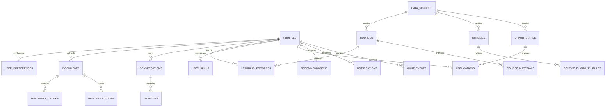

# Database Engineering Blueprint — AccessAI

**Database Engine:** PostgreSQL 16  
**Vector Extension:** pgvector (`VECTOR(384)`)  
**Security Architecture:** Supabase Row-Level Security (RLS)  
**Migration Path:** `supabase/migrations/`  

---

## 1. Entity-Relationship Diagram (ERD)



---

## 2. Table Specifications & Schema Definitions

### 2.1 Identity, Users & Accessibility Preferences

#### `profiles`
Extends Supabase `auth.users` with civic and educational attributes.

| Column | Type | Constraints | Description |
|---|---|---|---|
| `id` | UUID | PRIMARY KEY, REFERENCES `auth.users(id)` ON DELETE CASCADE | Unique user identifier matching Supabase Auth UID |
| `full_name` | TEXT | NULLABLE | Citizen's full name |
| `education_level` | TEXT | NULLABLE | Highest education level (`school`, `diploma`, `undergraduate`, `graduate`) |
| `preferred_language` | TEXT | DEFAULT 'en' | Preferred interface and output language code (`en`, `te`, `hi`, etc.) |
| `country_code` | TEXT | DEFAULT 'IN' | Country code (ISO 3166-1 alpha-2) |
| `state_code` | TEXT | NULLABLE | State of domicile (e.g. `AP`, `TS`, `MH`, `DL`, `UP`) |
| `annual_family_income` | NUMERIC | NULLABLE | Total annual household income in Indian Rupees (INR) |
| `category` | TEXT | NULLABLE | Affirmative action or social category (e.g. `General`, `OBC`, `SC`, `ST`, `BC-A`) |
| `accessibility_preferences` | JSONB | DEFAULT '{}' | Client-side UI customization settings |
| `skills` | TEXT[] | DEFAULT '{}' | Normalized array of verified skills |
| `created_at` | TIMESTAMPTZ | DEFAULT NOW() | Timestamp of record creation |
| `updated_at` | TIMESTAMPTZ | DEFAULT NOW() | Timestamp of last profile update (maintained by trigger) |

#### `user_preferences`
Dedicated accessibility controls persisted across devices.

| Column | Type | Constraints | Description |
|---|---|---|---|
| `id` | UUID | PRIMARY KEY DEFAULT gen_random_uuid() | Primary key |
| `user_id` | UUID | UNIQUE, REFERENCES `profiles(id)` ON DELETE CASCADE | Foreign key to user profile |
| `voice_enabled` | BOOLEAN | DEFAULT FALSE | Enables automatic audio narration of responses |
| `simplified_language` | BOOLEAN | DEFAULT FALSE | Enforces 6th-grade reading level simplification |
| `high_contrast` | BOOLEAN | DEFAULT FALSE | Enforces high-contrast UI theme |
| `font_scale` | NUMERIC | DEFAULT 1.0 | Visual text scale factor (0.8 to 2.0) |
| `preferred_output` | TEXT | DEFAULT 'text' | Primary output mode (`text`, `audio`, `summary`) |
| `additional_languages` | TEXT[] | DEFAULT '{}' | Additional spoken languages |

---

### 2.2 Documents, Ingestion & Vector Storage

#### `documents`
Uploaded digital artifacts, certificates, circulars, and textbooks.

| Column | Type | Constraints | Description |
|---|---|---|---|
| `id` | UUID | PRIMARY KEY DEFAULT gen_random_uuid() | Unique document ID |
| `user_id` | UUID | REFERENCES `profiles(id)` ON DELETE CASCADE | Document owner UID |
| `filename` | TEXT | NOT NULL | Original uploaded filename |
| `storage_path` | TEXT | NOT NULL | Path in Supabase encrypted storage bucket |
| `mime_type` | TEXT | NOT NULL | MIME type (`application/pdf`, `image/png`, `text/plain`) |
| `status` | TEXT | DEFAULT 'uploaded' | Ingestion status (`uploaded`, `processing`, `completed`, `failed`) |
| `detected_language` | TEXT | NULLABLE | Primary language detected by OCR/parser |
| `extracted_text` | TEXT | NULLABLE | Full raw extracted text from file |
| `simplified_text` | TEXT | NULLABLE | Plain language representation of document |
| `translated_text` | TEXT | NULLABLE | Native language translation |
| `page_count` | INTEGER | DEFAULT 1 | Total page count |
| `metadata` | JSONB | DEFAULT '{}' | Document attributes (file size, MD5 hash, parser info) |
| `created_at` | TIMESTAMPTZ | DEFAULT NOW() | Ingestion timestamp |

#### `document_chunks` (Vector Store)
Partitioned semantic chunks for RAG operations with pgvector embeddings.

| Column | Type | Constraints | Description |
|---|---|---|---|
| `id` | UUID | PRIMARY KEY DEFAULT gen_random_uuid() | Chunk unique ID |
| `document_id` | UUID | REFERENCES `documents(id)` ON DELETE CASCADE | Parent document reference |
| `user_id` | UUID | REFERENCES `profiles(id)` ON DELETE CASCADE | User ID for strict tenant isolation |
| `chunk_index` | INTEGER | NOT NULL | Sequential chunk order index (0, 1, 2, ...) |
| `content` | TEXT | NOT NULL | Chunk text content (350-500 words) |
| `page_number` | INTEGER | DEFAULT 1 | Original document page number for citation |
| `language` | TEXT | DEFAULT 'en' | Language of chunk content |
| `embedding` | VECTOR(384) | NULLABLE | 384-dimensional dense semantic embedding |
| `metadata` | JSONB | DEFAULT '{}' | Character offsets, word count, section heading |
| `created_at` | TIMESTAMPTZ | DEFAULT NOW() | Chunk generation timestamp |

*Constraint:* `UNIQUE(document_id, chunk_index)`

#### `processing_jobs`
Tracks asynchronous document processing jobs.

| Column | Type | Constraints | Description |
|---|---|---|---|
| `id` | UUID | PRIMARY KEY DEFAULT gen_random_uuid() | Job ID |
| `user_id` | UUID | REFERENCES `profiles(id)` ON DELETE CASCADE | User owner |
| `resource_type` | TEXT | NOT NULL | Type (`document`, `resume`, `audio`) |
| `resource_id` | UUID | NOT NULL | ID of target resource |
| `job_type` | TEXT | NOT NULL | Operation (`ocr`, `embedding`, `translation`, `simplification`) |
| `status` | TEXT | DEFAULT 'pending' | Execution state (`pending`, `running`, `completed`, `failed`) |
| `error_message` | TEXT | NULLABLE | Failure description if failed |
| `progress_percentage` | INTEGER | DEFAULT 0 | Job completion percentage (0 to 100) |

---

### 2.3 Conversations & Messages

#### `conversations`
Multi-turn dialogue sessions scoped by module.

| Column | Type | Constraints | Description |
|---|---|---|---|
| `id` | UUID | PRIMARY KEY DEFAULT gen_random_uuid() | Conversation ID |
| `user_id` | UUID | REFERENCES `profiles(id)` ON DELETE CASCADE | Owning citizen UID |
| `module` | TEXT | NOT NULL | Domain module (`access`, `education`, `schemes`, `opportunities`) |
| `title` | TEXT | NULLABLE | User-facing session title |

#### `messages`
Individual conversational turns with verified citations.

| Column | Type | Constraints | Description |
|---|---|---|---|
| `id` | UUID | PRIMARY KEY DEFAULT gen_random_uuid() | Message ID |
| `conversation_id` | UUID | REFERENCES `conversations(id)` ON DELETE CASCADE | Conversation reference |
| `role` | TEXT | NOT NULL | Message role (`user`, `assistant`, `system`) |
| `content` | TEXT | NOT NULL | Message text |
| `citations` | JSONB | DEFAULT '[]' | Verified citations (`document_id`, `page_number`, `chunk_index`, `quoted_text`) |
| `metadata` | JSONB | DEFAULT '{}' | Evidence tier, confidence score, tokens used |

---

### 2.4 EduBridge: Curriculum & Learning

#### `courses` & `course_materials`
Curated educational materials and learning paths.

- **`courses`**: `id`, `title`, `description`, `language`, `difficulty_level`, `source_id`, `metadata`.
- **`course_materials`**: `id`, `course_id` (FK), `title`, `content`, `order_index`.

#### `learning_progress` & `quiz_attempts`
User mastery and formative assessment records.

- **`learning_progress`**: `id`, `user_id` (FK), `course_id` (FK), `progress` (0-100%), `mastery_score` (0-100), `current_topic`.
- **`quiz_attempts`**: `id`, `user_id` (FK), `course_id` (FK), `score`, `total_questions`, `gap_analysis` (JSONB).

---

### 2.5 SchemeConnect: Government Public Services

#### `schemes`
Official government schemes pre-seeded and verified.

| Column | Type | Constraints | Description |
|---|---|---|---|
| `id` | UUID | PRIMARY KEY DEFAULT gen_random_uuid() | Scheme unique ID |
| `name` | TEXT | NOT NULL | Official scheme name |
| `description` | TEXT | NULLABLE | Scheme overview and benefits description |
| `official_url` | TEXT | NULLABLE | Official `.gov.in` portal URL |
| `source_id` | UUID | REFERENCES `data_sources(id)` ON DELETE SET NULL | Authoritative data source reference |
| `state_code` | TEXT | NULLABLE | `NULL` for Central (All India) or state code (e.g. `AP`) |
| `eligibility` | JSONB | DEFAULT '{}' | High-level summary of eligibility |
| `required_documents` | JSONB | DEFAULT '[]' | JSON list of required submission documents |
| `application_deadline` | TIMESTAMPTZ | NULLABLE | Official application deadline |
| `status` | TEXT | DEFAULT 'active' | Scheme operational status (`active`, `expired`, `upcoming`) |

#### `scheme_eligibility_rules`
Structured criteria rules evaluated deterministically by `RuleEvaluator`.

| Column | Type | Constraints | Description |
|---|---|---|---|
| `id` | UUID | PRIMARY KEY DEFAULT gen_random_uuid() | Rule unique ID |
| `scheme_id` | UUID | REFERENCES `schemes(id)` ON DELETE CASCADE | Parent scheme reference |
| `rule_key` | TEXT | NOT NULL | User profile attribute key (`annual_family_income`, `state_code`, `education_level`, `gender`, `category`) |
| `operator` | TEXT | NOT NULL | Evaluation operator (`==`, `!=`, `<=`, `>=`, `<`, `>`, `in`, `contains`) |
| `expected_value` | JSONB | NOT NULL | Expected value or array (e.g. `250000`, `"AP"`, `["diploma", "undergraduate"]`) |
| `is_mandatory` | BOOLEAN | DEFAULT TRUE | If true, failing this rule disqualifies applicant |
| `description` | TEXT | NULLABLE | Human-readable requirement explanation |

---

### 2.6 OpportunityBridge: Careers & Matching

#### `opportunities`
Jobs, internships, hackathons, and scholarships.

- **`opportunities`**: `id`, `title`, `description`, `opportunity_type`, `organization`, `location`, `official_url`, `required_skills` (JSONB), `eligibility` (JSONB), `deadline`, `status`.
- **`user_skills`**: `id`, `user_id` (FK), `skill_name`, `proficiency`, `evidence` (JSONB).
- **`applications`**: `id`, `user_id` (FK), `opportunity_id` (FK), `application_status` (`interested`, `applied`, `interviewing`, `offered`, `rejected`), `notes`.
- **`recommendations`**: `id`, `user_id` (FK), `item_type`, `item_id`, `score` (0-100), `explanation`, `metadata`.

---

### 2.7 Platform Governance & Security

#### `data_sources`
Tracks verified official government and educational authorities.
- Columns: `id`, `name`, `source_url`, `source_type`, `authority_level`, `last_verified_at`, `is_active`.

#### `audit_events`
Immutable append-only audit trail for compliance and security events.
- Columns: `id`, `user_id`, `event_type`, `resource_type`, `resource_id`, `metadata`, `created_at`.

#### `notifications`
Citizen notification feed for application deadlines and eligibility matches.
- Columns: `id`, `user_id`, `title`, `body`, `notification_type`, `action_url`, `read_at`, `created_at`.

---

## 3. Indexing Strategy & Vector Optimization

```sql
-- 1. pgvector Cosine Distance Index
CREATE INDEX IF NOT EXISTS idx_chunks_embedding ON document_chunks 
USING ivfflat (embedding vector_cosine_ops) WITH (lists = 100);

-- 2. Tenant Isolation Indexes (Fast joins and RLS validation)
CREATE INDEX IF NOT EXISTS idx_documents_user ON documents(user_id);
CREATE INDEX IF NOT EXISTS idx_chunks_user ON document_chunks(user_id);
CREATE INDEX IF NOT EXISTS idx_chunks_document ON document_chunks(document_id);
CREATE INDEX IF NOT EXISTS idx_conversations_user ON conversations(user_id);
CREATE INDEX IF NOT EXISTS idx_messages_conversation ON messages(conversation_id);

-- 3. Filter Indexes for Scheme & Opportunity Discovery
CREATE INDEX IF NOT EXISTS idx_schemes_state ON schemes(state_code);
CREATE INDEX IF NOT EXISTS idx_schemes_deadline ON schemes(application_deadline);
CREATE INDEX IF NOT EXISTS idx_scheme_rules_scheme ON scheme_eligibility_rules(scheme_id);
CREATE INDEX IF NOT EXISTS idx_opportunities_deadline ON opportunities(deadline);
CREATE INDEX IF NOT EXISTS idx_opportunities_type ON opportunities(opportunity_type);
CREATE INDEX IF NOT EXISTS idx_recommendations_user ON recommendations(user_id);
CREATE INDEX IF NOT EXISTS idx_notifications_user ON notifications(user_id);
CREATE INDEX IF NOT EXISTS idx_audit_events_user ON audit_events(user_id);
```

---

## 4. Row-Level Security (RLS) Policy Matrix

| Table | SELECT | INSERT | UPDATE | DELETE |
|---|---|---|---|---|
| `profiles` | `auth.uid() = id` | `auth.uid() = id` | `auth.uid() = id` | `auth.uid() = id` |
| `user_preferences` | `auth.uid() = user_id` | `auth.uid() = user_id` | `auth.uid() = user_id` | `auth.uid() = user_id` |
| `documents` | `auth.uid() = user_id` | `auth.uid() = user_id` | `auth.uid() = user_id` | `auth.uid() = user_id` |
| `document_chunks` | `auth.uid() = user_id` | `auth.uid() = user_id` | Denied | `auth.uid() = user_id` |
| `processing_jobs` | `auth.uid() = user_id` | `auth.uid() = user_id` | Service Role Only | Service Role Only |
| `conversations` | `auth.uid() = user_id` | `auth.uid() = user_id` | `auth.uid() = user_id` | `auth.uid() = user_id` |
| `messages` | Conversation Owner | Conversation Owner | Denied (Immutable) | Conversation Owner |
| `schemes` | `status = 'active'` (Public) | Service Role Only | Service Role Only | Service Role Only |
| `scheme_eligibility_rules` | Public via Active Scheme | Service Role Only | Service Role Only | Service Role Only |
| `opportunities` | `status = 'active'` (Public) | Service Role Only | Service Role Only | Service Role Only |
| `applications` | `auth.uid() = user_id` | `auth.uid() = user_id` | `auth.uid() = user_id` | `auth.uid() = user_id` |
| `audit_events` | `auth.uid() = user_id` | Authenticated Users | Denied (Append-Only) | Denied |
| `notifications` | `auth.uid() = user_id` | Service Role Only | `auth.uid() = user_id` | `auth.uid() = user_id` |

---

## 5. Seed Dataset Plan

`supabase/seed.sql` populates the initial database with verified government schemes and opportunities:
1. **PM-KISAN:** Central income support of ₹6,000/year for farmer households. Rule: `category == 'farmer'`.
2. **Jagananna Vidya Deevena:** Andhra Pradesh full fee reimbursement for higher education. Rules: `state_code == 'AP'`, `annual_family_income <= 250000`, `education_level in ['diploma', 'undergraduate', 'postgraduate']`.
3. **AICTE Pragati:** Central scholarship of ₹50,000/year for girl students in technical education. Rules: `gender == 'female'`, `annual_family_income <= 800000`.
4. **Post-Matric Scholarship for Minorities:** Central welfare scholarship under Ministry of Minority Affairs.
5. **Real-world Opportunities:** AssistiveTech Labs Internship, MeitY Digital India AI Hackathon, Bharat Cloud Solutions Backend Engineer role.

