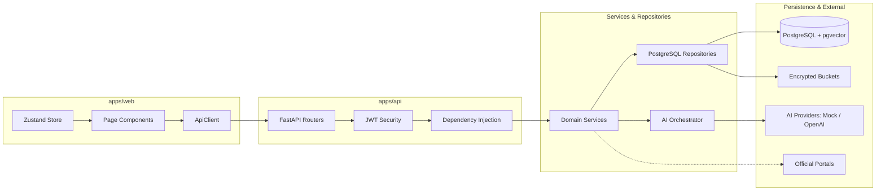

# System Integration Plan — AccessAI

**Document Version:** 1.0.0  
**Target:** Monorepo Integration & Live Service Transitions  
**Scope:** Frontend-to-Backend, Database Persistence, AI Providers, Document Pipeline  

---

## 1. Integration Landscape & Target State

---

## 2. Integration Stream 1: Frontend-to-Backend Migration

### Current State
Next.js pages currently initialize static state via `useState` and simulate async latency with `setTimeout(..., 400)` to present an interactive UI without connecting to the network.

### Integration Strategy
1. **Connect `ApiClient` to Page Handlers:**
   - In `apps/web/src/app/(dashboard)/access/page.tsx`: Replace `handleAsk` simulated timeout with `await ApiClient.askDocument({ document_id, question, language })`.
   - In `apps/web/src/app/(dashboard)/schemes/page.tsx`: Replace hardcoded `schemes` array with `await ApiClient.listSchemes(userProfile.state_code)` and `await ApiClient.matchSchemes({ profile: userProfile })`.
   - In `apps/web/src/app/(dashboard)/education/page.tsx`: Replace simulated tutor chat with `await ApiClient.tutorChat(message, courseId, activeLanguage)`.
   - In `apps/web/src/app/(dashboard)/opportunities/page.tsx`: Replace static opportunity cards with `await ApiClient.matchOpportunities({ profile: userProfile })`.
   - In `apps/web/src/app/(dashboard)/documents/page.tsx`: Connect file dropzone to `await ApiClient.uploadDocument(formData)`.
   - In `apps/web/src/app/(dashboard)/profile/page.tsx`: Load initial profile via `await ApiClient.getProfile()` and save updates via `ApiClient.updateProfile(data)`.
2. **State & Error Handling Pattern:**
   - Standardize loading spinners and alert banners for error envelopes (`ApiErrorResponse`).
   - Sync accessibility preferences with `ApiClient.updatePreferences()` on change.

---

## 3. Integration Stream 2: Database Persistence Migration

### Current State
Backend repositories in `apps/api/app/modules/*/repository.py` use in-memory dictionaries (`_DOCUMENTS_STORE`, `_SCHEMES_STORE`, etc.).

### Integration Strategy
1. **Database Connection Setup:**
   - Configure SQLAlchemy 2.0 async engine and sessionmaker in `apps/api/app/database/session.py` consuming `settings.DATABASE_URL`.
2. **Repository Implementation:**
   - `DocumentRepository`: Replace dictionary operations with SQLAlchemy queries to `documents` and `document_chunks` tables.
   - `SchemeRepository`: Query `schemes` and `scheme_eligibility_rules` tables with state and category filters.
   - `OpportunityRepository`: Query `opportunities` table with status and type filters.
   - `EducationRepository`: Query `courses` and `learning_progress` tables.
3. **Tenant Isolation Enforcement:**
   - All repository methods require `user_id: str` and enforce `WHERE user_id = :user_id` on document, chunk, conversation, and progress operations.

---

## 4. Integration Stream 3: AI Provider & Multimodal Ingestion

### Current State
`MockAIProvider` generates synthetic completions; `openai_provider.py` is missing; document upload decodes UTF-8 strings directly.

### Integration Strategy
1. **Implement `OpenAIProvider`:**
   - Create `apps/api/app/intelligence/providers/openai_provider.py` implementing `AIProvider` base class.
   - Use `httpx` or official SDK with JSON schema enforcement via Pydantic models.
   - Support environment variable fallback: if `LLM_API_KEY` is empty, fallback to `MockAIProvider`.
2. **Implement Native PDF Parsing:**
   - In `apps/api/app/services/document_processing/pdf_parser.py`: Use `fitz` (PyMuPDF) to extract text by blocks, tracking page numbers and font headings.
3. **Dense Vector Embeddings:**
   - Local: Use `sentence-transformers` with `paraphrase-multilingual-MiniLM-L12-v2`.
   - Cloud: Fallback to OpenAI `text-embedding-3-small` (or unit vector generation in mock mode).

---

## 5. Integration Stream 4: External Public Data Ingestion

### Current State
Authoritative schemes are populated via `supabase/seed.sql`.

### Integration Strategy
1. **Authoritative Scheme Ingestion:**
   - Create synchronization scripts in `apps/api/app/integrations/government_sources/` to ingest structured JSON from `myScheme.gov.in` and `scholarships.gov.in`.
   - Normalize scheme eligibility criteria into `scheme_eligibility_rules` records with exact Boolean operators.
2. **Verification & Freshness Auditing:**
   - Each external scheme record maintains `source_id`, `last_verified_at`, and `authority_level` (`official`, `accredited`, `third_party`).

---

## 6. Verification & Step-by-Step Testing Gates

| Step | Integration Action | Verification Test |
|---|---|---|
| **Step 1** | Run `docker-compose up -d db` | Database is healthy (`pg_isready -U postgres -d accessai`). |
| **Step 2** | Execute Supabase SQL migrations & seeds | 16 tables created with RLS; 4 schemes and 3 opportunities seeded. |
| **Step 3** | Start FastAPI backend | `GET /api/v1/health` returns `database: connected`. |
| **Step 4** | Run Python integration test suite | `./scripts/run_tests.sh` passes all 17 tests. |
| **Step 5** | Upload sample PDF via `/documents/upload` | Document record created; chunks indexed with embeddings in `document_chunks`. |
| **Step 6** | Execute `/access/ask` with Telugu query | Returns grounded Telugu answer with Tier 2 document citation. |
| **Step 7** | Execute `/schemes/match` with AP student profile | Returns `Jagananna Vidya Deevena` as `ELIGIBLE` with green Tier 1 badge. |
| **Step 8** | Execute `/opportunities/match` with resume profile | Returns scored matches with formula breakdown and missing skill links. |
| **Step 9** | End-to-end browser walkthrough | User logs in, uploads document, chats with tutor, checks schemes, matches jobs. |

