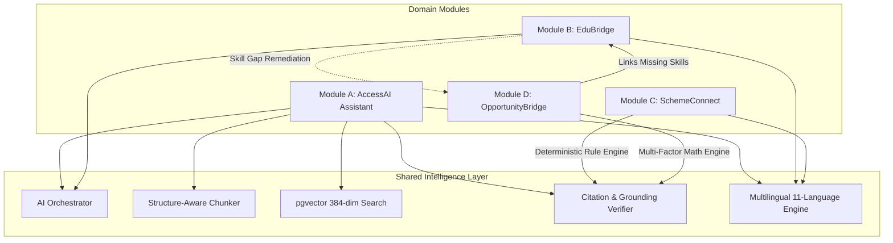

# Domain Module Specifications — AccessAI

**Document Version:** 1.0.0  
**Scope:** Functional & Technical Specifications for 4 Core Modules  
**Compliance Target:** WCAG 2.2 AA / Zero Hallucination Standard  

---

## 1. Module Overview & Dependency Graph

AccessAI decomposes functionality into **4 Domain Modules** communicating through explicit service interfaces and powered by a single **Shared Intelligence Layer**.

---

## 2. Module A: AccessAI Assistant (Universal Intelligence Engine)

### 2.1 Purpose & Target Users
The central multimodal assistant providing document ingestion, optical character recognition (OCR), plain language simplification, native language translation, and grounded Q&A with strict anti-hallucination guardrails. Serves citizens deciphering bureaucratic notices and students reviewing technical materials.

### 2.2 Functional Capabilities
1. **Multimodal Ingestion Pipeline:**
   - Ingests native PDFs, scanned PDF documents, images (PNG, JPG), and plain text.
   - Extracts structured text using PyMuPDF (extracting page numbers, headings, and character bounds) or PaddleOCR for physical scans.
2. **5-Way Adaptive Content Transformation:**
   From any uploaded document, the assistant generates 5 simultaneous representations:
   - *Plain Language Summary:* Simplifies complex legalese to a 6th-grade reading level.
   - *Native Language Translation:* Translates into any of 11 supported Indian regional languages.
   - *Audio Narration:* Inline Text-to-Speech (TTS) readout.
   - *Key Facts & Deadlines Table:* Structured extraction of critical submission dates, income limits, and eligibility criteria.
   - *Document Submission Checklist:* Actionable checklist of mandatory certificates.
3. **Grounded RAG Q&A:**
   - Vector search on 384-dimensional dense embeddings (`VECTOR(384)`).
   - Strict context sandboxing using `<untrusted_document_context>`.
   - Returns verified citations with exact page numbers and verbatim quotations.

### 2.3 Technical Implementation
- **Service Class:** `AccessService` (`apps/api/app/modules/access/service.py`)
- **Repository:** `DocumentRepository` (`apps/api/app/modules/access/repository.py`)
- **Intelligence Dependencies:** `AIOrchestrator`, `StructureAwareChunker`, `GroundingVerifier`
- **Database Tables:** `documents`, `document_chunks`, `processing_jobs`

---

## 3. Module B: EduBridge (Educational Access & Tutoring)

### 3.1 Purpose & Target Users
An interactive personalized AI tutor designed for first-generation learners, rural students, and college attendees facing complex textbooks in English. Provides curriculum-aligned explanations, difficulty adjustments, and formative assessments.

### 3.2 Functional Capabilities
1. **Contextual AI Tutor:**
   - Interactive dialogue grounded in uploaded lecture notes, syllabi, or pre-seeded courses (e.g. Python Programming, Web Development).
   - Explains abstract concepts through everyday cultural analogies (e.g. loops explained via Indian rail ticketing or school assembly).
2. **Difficulty Adaptation:**
   - Dynamically rephrases explanations based on requested difficulty:
     - *Beginner:* Conceptual analogies, plain language, no prior jargon assumed.
     - *High School:* Standard foundational definitions with introductory examples.
     - *Advanced:* Deep technical dive, performance trade-offs, and algorithmic rigor.
3. **Formative Quiz & Knowledge Gap Generation:**
   - Generates structured multiple-choice quiz questions with distractor explanations.
   - Diagnoses incorrect answers, tags the missing foundational concept, and suggests targeted review topics.
4. **Personalized Learning Pathways:**
   - Constructs visual step-by-step learning progression roadmaps based on target career roles.

### 3.3 Technical Implementation
- **Service Class:** `EducationService` (`apps/api/app/modules/education/service.py`)
- **Repository:** `EducationRepository` (`apps/api/app/modules/education/repository.py`)
- **Database Tables:** `courses`, `course_materials`, `learning_progress`, `quiz_attempts`

---

## 4. Module C: SchemeConnect (Public Services & Welfare)

### 4.1 Purpose & Target Users
Discovers and verifies eligibility for official Central and State government welfare schemes (scholarships, tuition fee reimbursement, agricultural income support) without legal confusion or false promises.

### 4.2 Functional Capabilities
1. **Authoritative Scheme Directory:**
   - Pre-seeded with verified official schemes:
     - *PM-KISAN:* ₹6,000/yr direct income support for farmers.
     - *Jagananna Vidya Deevena (RTF):* 100% tuition reimbursement for higher education in Andhra Pradesh.
     - *AICTE Pragati Scholarship:* ₹50,000/yr for female technical degree/diploma students.
     - *National Scholarship Portal (NSP) Post-Matric Minority Schemes.*
   - Tracks official `.gov.in` source URLs and verification timestamps.
2. **Deterministic Rule Engine (`RuleEvaluator`):**
   - **Zero Hallucination Guarantee:** The LLM is strictly prohibited from evaluating or declaring eligibility.
   - Evaluates citizen profile attributes against structured criteria rules:
     - `annual_family_income <= 250000`
     - `state_code == "AP"`
     - `education_level IN ["diploma", "undergraduate", "postgraduate"]`
     - `gender == "female"`
3. **Evaluation Classifications:**
   - `ELIGIBLE`: All mandatory rules satisfied.
   - `POTENTIALLY_ELIGIBLE`: Some rules satisfied, other attributes unknown.
   - `NOT_ELIGIBLE`: At least one mandatory rule failed.
   - `INSUFFICIENT_INFORMATION`: Key profile attributes missing.
4. **Actionable Application Roadmaps:**
   - Generates step-by-step application guidance and required official certificate checklists.

### 4.3 Technical Implementation
- **Service Class:** `SchemeService` (`apps/api/app/modules/schemes/service.py`)
- **Rule Engine:** `RuleEvaluator` (`apps/api/app/modules/schemes/eligibility.py`)
- **Repository:** `SchemeRepository` (`apps/api/app/modules/schemes/repository.py`)
- **Database Tables:** `schemes`, `scheme_eligibility_rules`, `data_sources`

---

## 5. Module D: OpportunityBridge (Careers & Matching)

### 5.1 Purpose & Target Users
Bridges the gap between underserved students and the modern job market. Analyzes resumes, matches opportunities (jobs, internships, scholarships, hackathons), and provides transparent mathematical rankings with skill-gap feedback.

### 5.2 Functional Capabilities
1. **Structured Resume Parsing:**
   - Extracts technical skills, education level, and certifications from plain text or PDF resumes.
2. **Multi-Factor Recommendation Formula:**
   Scores matches using the weighted multi-factor equation:
   $$S = w_1E + w_2R + w_3P + w_4F$$
   - $w_1 = 0.40$: Mandatory eligibility compliance (hard gate).
   - $w_2 = 0.35$: Semantic relevance between user skills and opportunity requirements.
   - $w_3 = 0.15$: Preference alignment (location, remote vs on-site).
   - $w_4 = 0.10$: Listing freshness and official verification score.
   - **Hard Constraint Rule:** If mandatory eligibility $E = 0$ (e.g. applicant lacks the required education degree), the final score is clamped to $S = 0.0$.
3. **Skill-Gap Analysis & EduBridge Integration:**
   - Explicitly identifies missing skills (e.g. "Matches Python, FastAPI, React; Missing TypeScript, Tailwind CSS").
   - Provides direct one-click links to EduBridge study modules to learn the missing competencies.
4. **Opportunity Pipeline Tracking:**
   - Citizens track application states: `interested` $\rightarrow$ `applied` $\rightarrow$ `interviewing` $\rightarrow$ `offered`.

### 5.3 Technical Implementation
- **Service Class:** `OpportunityService` (`apps/api/app/modules/opportunities/service.py`)
- **Parsing Engine:** `ResumeParser` (`apps/api/app/modules/opportunities/resume_parser.py`)
- **Scoring Engine:** `RecommendationEngine` (`apps/api/app/intelligence/recommendations/engine.py`)
- **Repository:** `OpportunityRepository` (`apps/api/app/modules/opportunities/repository.py`)
- **Database Tables:** `opportunities`, `user_skills`, `applications`, `recommendations`

---

## 6. Inter-Module Communication Laws

As defined in `AGENTS.md`:
1. Modules reside in `apps/api/app/modules/` and communicate exclusively via Python service interfaces.
2. Direct SQL queries into another module's database tables or internal repositories are forbidden.
3. OpportunityBridge communicates with EduBridge by passing required skill tags to generate learning path recommendations.
4. SchemeConnect eligibility evaluations feed verified citizen attributes into OpportunityBridge for affirmative action / diversity hiring filters.

