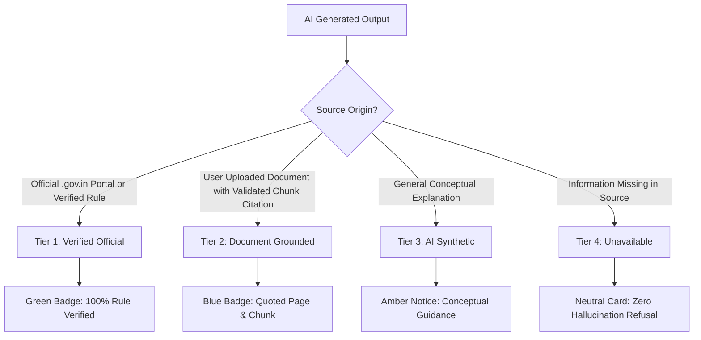
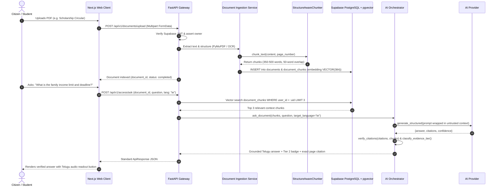
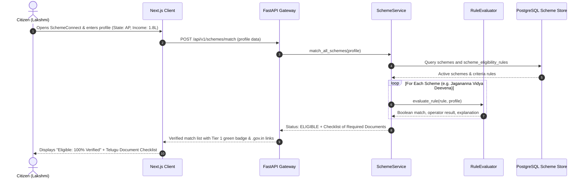

# System Architecture Blueprint — AccessAI

**Document Version:** 1.0.0  
**Architectural Pattern:** Modular Monolith  
**Compliance Target:** WCAG 2.2 AA  
**Platform Target:** Universal Multilingual Access & Empowerment  

---

## 1. Six-Tier Architectural Model

AccessAI is structured as a **Modular Monolith**. It consolidates all domain capabilities into a single, cohesive codebase with strict internal boundaries, sharing a high-performance intelligence layer rather than operating distributed microservices.

```
+-----------------------------------------------------------------------------------------+
|                                1. PRESENTATION LAYER                                    |
|   Next.js 15 (App Router) · React 19 · TypeScript · Tailwind CSS · Accessible UI Shell  |
|   - Universal Dashboard   - Voice Transcriber / TTS   - Accessibility Controls Toolbar  |
|   - High Contrast Engine  - Screen-Reader ARIA Live   - Font Scaling (0.8x - 2.0x)      |
+-----------------------------------------------------------------------------------------+
                                          |
                                   HTTPS / REST API
                                          |
+-----------------------------------------------------------------------------------------+
|                               2. API & SECURITY GATEWAY                                 |
|   FastAPI · Supabase JWT Authentication · RBAC · Rate Limiting · Request ID Correlation |
|   - Middleware: RequestContextMiddleware, SecurityHeaders, PII Masking, ErrorHandler    |
|   - Dependency Injection: CurrentUser, Service Singletons, StorageService               |
+-----------------------------------------------------------------------------------------+
                                          |
+-----------------------------------------------------------------------------------------+
|                             3. SHARED INTELLIGENCE LAYER                                |
|   Reusable Platform AI Services (`apps/api/app/intelligence/`)                          |
|   +-----------------------+ +------------------------+ +------------------------------+ |
|   | AI Orchestrator       | | RAG & Vector Retrieval | | Multilingual Engine          | |
|   | (Intent & Routing)    | | (pgvector 384-dim)     | | (11 Indic Languages)         | |
|   +-----------------------+ +------------------------+ +------------------------------+ |
|   +-----------------------+ +------------------------+ +------------------------------+ |
|   | Vision & OCR Engine   | | Speech (STT / TTS)     | | Recommendation Math Engine   | |
|   | (PyMuPDF / PaddleOCR) | | (WebSpeech / Bhashini) | | (S = w1E + w2R + w3P + w4F)  | |
|   +-----------------------+ +------------------------+ +------------------------------+ |
|   +-----------------------------------------------------------------------------------+ |
|   | Trust & Grounding Engine (Source Attributions, Citation Validation, Anti-Hallucin)| |
|   +-----------------------------------------------------------------------------------+ |
+-----------------------------------------------------------------------------------------+
                                          |
        +--------------------+------------+---------------+--------------------+
        |                    |                            |                    |
+--------------+   +-------------------+        +-----------------+   +------------------+
| 4A. AccessAI |   | 4B. EduBridge     |        | 4C. SchemeCon   |   | 4D. OppBridge    |
| Universal    |   | Contextual Tutor  |        | Deterministic   |   | Resume Parser    |
| Document Q&A |   | Concept Extractor |        | Eligibility     |   | Skill Gap Match  |
| Translation  |   | Quiz Generator    |        | Scheme Rules    |   | Ranking Engine   |
| Audio Summary|   | Learning Pathways |        | Official Docs   |   | Opportunity Feed |
+--------------+   +-------------------+        +-----------------+   +------------------+
        |                    |                            |                    |
+-----------------------------------------------------------------------------------------+
|                            5. DATA ACCESS & REPOSITORIES                                |
|   Repository Pattern · Domain Interfaces · PostgreSQL Session Management                |
|   - DocumentRepo · ConversationRepo · SchemeRepo · OpportunityRepo · UserRepo           |
+-----------------------------------------------------------------------------------------+
                                          |
+-----------------------------------------------------------------------------------------+
|                            6. PERSISTENCE & INTEGRATIONS                                |
|   - PostgreSQL 16 + pgvector (Supabase Managed / Local Container)                       |
|   - Supabase Storage (Private Encrypted Buckets with Signed URLs)                       |
|   - External Authoritative Feeds (National Scholarship Portal, myScheme, Official APIs) |
+-----------------------------------------------------------------------------------------+
```

---

## 2. Tier-by-Tier Architectural Breakdown

### Tier 1: Presentation Layer (`apps/web`)
- **Technology:** Next.js 15 (App Router), React 19, TypeScript, Tailwind CSS, Lucide icons, Zustand.
- **Accessibility Engine:**
  - `AccessibilityToolbar.tsx`: Top-level accessible control bar providing dynamic font scaling (0.8x to 2.0x via CSS `--font-scale`), high-contrast color scheme switching via `.high-contrast` DOM class, and Web Speech API text-to-speech narration.
  - Multi-language UI switcher supporting English and 10 Indian regional languages (Telugu, Hindi, Tamil, Kannada, Malayalam, Bengali, Marathi, Gujarati, Punjabi, Odia).
- **Client Architecture:**
  - `ApiClient`: Strongly typed HTTP client consuming `@accessai/contracts`.
  - Responsive layout with accessible navigation sidebar (`Sidebar.tsx`), ARIA live regions, and visible keyboard focus rings (`focus-visible:ring-4 focus-visible:ring-primary`).

### Tier 2: API & Security Gateway (`apps/api/app/api/` & `apps/api/app/core/`)
- **Technology:** FastAPI, Uvicorn, Starlette Middleware, PyJWT.
- **Middleware Pipeline:**
  1. `RequestContextMiddleware`: Injects a unique `X-Request-ID` into request state and logs request execution latency via `X-Response-Time-Ms`.
  2. Security Headers: Enforces `X-Content-Type-Options: nosniff`, `X-Frame-Options: DENY`, `Referrer-Policy: strict-origin-when-cross-origin`.
  3. PII Masking: Automatically masks 12-digit Indian Aadhaar numbers (`\b\d{4}\s\d{4}\s\d{4}\b`), 10-character Permanent Account Numbers (`[A-Z]{5}[0-9]{4}[A-Z]{1}`), and JWT bearer tokens before logging.
- **Authentication & Authorization:**
  - `verify_jwt_token()`: Decodes and verifies Supabase JWT signatures (`HS256`).
  - `assert_resource_owner()`: Verifies that authenticated user tokens match the requested resource `user_id` preventing IDOR (Insecure Direct Object Reference) vulnerabilities.

### Tier 3: Shared Intelligence Layer (`apps/api/app/intelligence/`)
- **AI Orchestrator (`orchestrator/orchestrator.py`):** Routes user requests to appropriate prompt pipelines with structured schemas and boundary delimiters (`<untrusted_document_context>`).
- **RAG & Chunking (`rag/chunker.py`):** `StructureAwareChunker` divides documents into 350-500 word chunks with 50-word overlaps, retaining paragraph bounds, page numbers, and character offsets.
- **Provider Abstraction (`providers/`):**
  - `AIProvider` base interface with `generate()`, `generate_structured()`, and `embed()`.
  - `MockAIProvider`: Deterministic provider for CI and offline local testing.
  - `OpenAIProvider`: Production provider for OpenAI/Azure/local vLLM endpoints.
- **Recommendation Engine (`recommendations/engine.py`):** Multi-factor hybrid matching:
  $$S = w_1E + w_2R + w_3P + w_4F$$
  - Hard constraint: $E=0$ immediately clamps $S=0$, ensuring that failing mandatory eligibility completely disqualifies an applicant regardless of semantic similarity.
- **Trust & Grounding Verifier (`verification/grounding.py`):** Inspects model output citations against actual retrieved chunks; categorizes output into 4 verification tiers.

### Tier 4: Domain Modules (`apps/api/app/modules/`)
1. **`access/` (Universal Assistant):** Manages document ingestion, chunk storage, grounded document Q&A, and plain language simplification.
2. **`education/` (EduBridge):** Handles course curriculum, conversational tutoring, difficulty adaptation, formative quiz generation, and learning path graphs.
3. **`schemes/` (SchemeConnect):** Implements `RuleEvaluator` for deterministic evaluation of public welfare schemes (income, state residence, caste category, education level).
4. **`opportunities/` (OpportunityBridge):** Provides resume parsing, skill-gap analysis, and opportunity ranking for jobs, internships, scholarships, and hackathons.

### Tier 5: Data Access & Repositories (`apps/api/app/modules/*/repository.py`)
- Implements the Repository Pattern, abstracting underlying database tables from domain business logic.
- Currently supported by memory stores for unit testing, migrating to SQLAlchemy 2.0 and Supabase client queries.

### Tier 6: Persistence & Storage (`supabase/`)
- **PostgreSQL 16:** 16 relational tables with cascading foreign keys and automatic `updated_at` triggers.
- **pgvector:** Dense vector store (`VECTOR(384)`) indexed using IVFFlat cosine similarity (`vector_cosine_ops`).
- **Row-Level Security:** Enforces strict multi-tenancy at the database engine level via `auth.uid() = user_id`.

---

## 3. Trust & Grounding Verification Hierarchy

To combat hallucination and misinformation in public welfare and education, AccessAI assigns every response to one of four verified tiers:



---

## 4. Architectural Laws & Domain Separation Rules

As mandated in `AGENTS.md`:

1. **Modular Monolith, Not Microservices:** All domain modules must reside in `apps/api/app/modules/`. They communicate via Python service interfaces, never by executing cross-module database joins or touching foreign repositories.
2. **AccessAI is the Shared Intelligence Engine:** EduBridge, SchemeConnect, and OpportunityBridge must consume services from `apps/api/app/intelligence/`; they must not write bespoke LLM prompt pipelines.
3. **Deterministic Rules Over Generative Hallucination:** In SchemeConnect, citizen eligibility must be computed by evaluating structured database criteria (`scheme_eligibility_rules`). LLMs are strictly forbidden from evaluating or promising scheme benefits.
4. **Opportunity Matching Discipline:** Hard qualification filters precede semantic matching. Opportunities must use the verified formula $S = w_1E + w_2R + w_3P + w_4F$ with human-readable rationale.
5. **Zero Cross-Tenant Leakage:** Supabase Row-Level Security (RLS) is enabled on every user-owned table. All vector queries on `document_chunks` must enforce `WHERE user_id = :auth_uid`.

---

## 5. End-to-End Data Flow Diagrams

### Flow 1: Document Ingestion & Grounded Q&A (AccessAI)



### Flow 2: Deterministic Scheme Eligibility Check (SchemeConnect)



