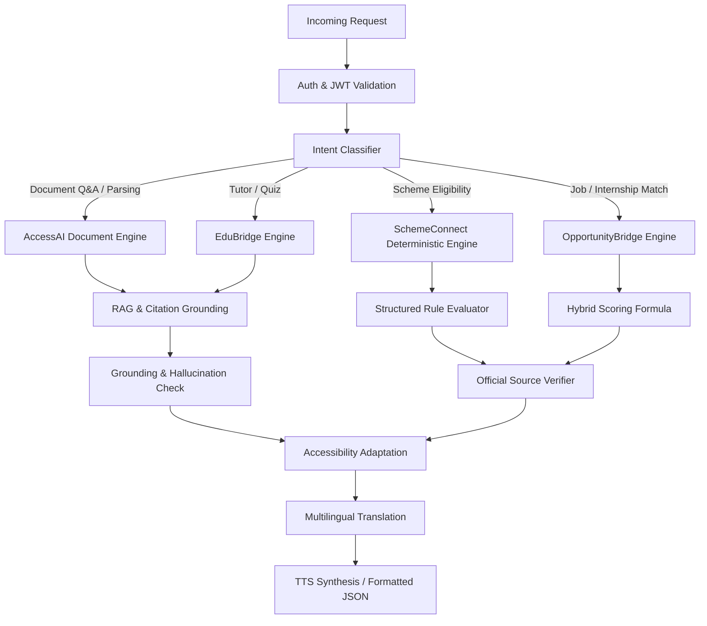

# AI & RAG Pipeline Engineering Blueprint — AccessAI

AccessAI centralizes all intelligence into a modular pipeline to guarantee safety, source traceability, and deterministic validation.

---

## 1. Orchestrator Workflow



---

## 2. Ingestion & RAG Specification

### Ingestion Pipeline
1. **Extraction**:
   - Native PDFs: `PyMuPDF` (extracting text blocks, font sizes, heading tags, page boundaries).
   - Scanned PDFs & Images: `PaddleOCR` / Tesseract with bounding-box extraction.
2. **Structure-Aware Chunking**:
   - Chunks respect heading hierarchy and paragraphs.
   - Target size: 300 to 500 tokens with 50-token semantic overlap.
   - Metadata attached: `page_number`, `document_id`, `chunk_index`, `section_title`.
3. **Multilingual Embedding**:
   - Model: `paraphrase-multilingual-MiniLM-L12-v2` (384 dimensions).
   - Enables cross-lingual similarity: queries in Telugu/Hindi match English source text.
4. **Vector Storage**:
   - Supabase `pgvector` with IVFFlat index (`vector_cosine_ops`).
   - Query filters strictly enforce `user_id = :current_user_id`.

---

## 3. Grounding & Anti-Hallucination Guardrails

- **Delimiter Enclosure**: Untrusted document text is passed inside strict boundary delimiters:
  ```text
  You are an evidence-grounded assistant. Answer the user question strictly using the provided context chunks.
  If the answer cannot be determined from the chunks, output:
  {"answer": "Information unavailable in the provided document.", "confidence": "none", "citations": []}
  
  <untrusted_document_context>
  [Page 1, Chunk 0]: ...
  [Page 2, Chunk 1]: ...
  </untrusted_document_context>
  ```
- **Citation Post-Validation**: Any output citations must match an actual `chunk_id` and `page_number` in the retrieved list; hallucinated citations are automatically stripped.

---

## 4. Multi-Factor Opportunity Scoring Formula

To prevent LLMs from inventing matches, OpportunityBridge calculates a deterministic match score $S \in [0, 100]$:

$$S = w_1E + w_2R + w_3P + w_4F$$

Where:
- **$E$ (Eligibility Gate, $w_1 = 0.40$):**
  - Binary compliance on education level, mandatory prerequisites, and graduation year.
  - If mandatory eligibility fails, $E = 0$ and $S$ is clamped to 0 (`not_eligible`).
- **$R$ (Semantic & Skill Relevance, $w_2 = 0.35$):**
  - Jaccard similarity of extracted skills combined with cosine similarity of profile summary vector.
  $$R = 0.6 \cdot \frac{|\text{UserSkills} \cap \text{JobSkills}|}{|\text{JobSkills}|} + 0.4 \cdot \cos(\vec{u}, \vec{j})$$
- **$P$ (Personal Preferences, $w_3 = 0.15$):**
  - Match on location (e.g., Remote / India / State), preferred role types (internship vs full-time).
- **$F$ (Freshness & Verification, $w_4 = 0.10$):**
  - Decay function based on days to deadline and source verification level.
