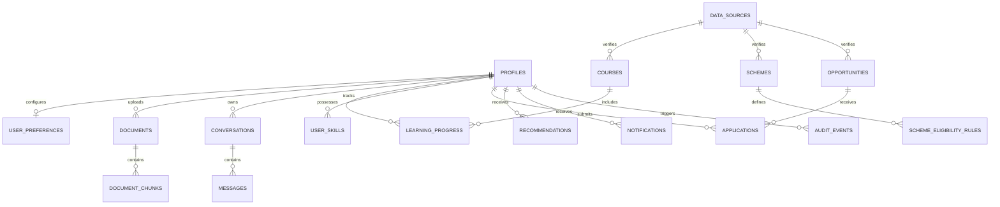

# Database Engineering Blueprint — AccessAI

AccessAI utilizes **PostgreSQL 16** with the **pgvector** extension, orchestrated via Supabase.

---

## 1. Entity-Relationship Model



---

## 2. Table Specifications

### Identity & Preferences
- **`profiles`**: User profile attributes (name, education level, state, language, skills). Primary Key references `auth.users(id)`.
- **`user_preferences`**: Accessibility toggles (`voice_enabled`, `simplified_language`, `font_scale`, `preferred_output`, `additional_languages`).

### Documents & Vector Store
- **`documents`**: Ingested files, storage paths, MIME types, processing status (`uploaded`, `processing`, `completed`, `failed`), detected language, full extracted text.
- **`document_chunks`**: Partitioned text chunks with 384-dimensional dense embeddings (`VECTOR(384)`), page numbers, chunk index, and metadata.
- **`processing_jobs`**: Background job queue records tracking OCR, translation, and embedding tasks.

### Dialogue & History
- **`conversations`**: Multi-turn dialogue sessions categorized by module (`access`, `education`, `schemes`, `opportunities`).
- **`messages`**: Dialogue history, role (`user`, `assistant`, `system`), text content, JSON citations (`document_id`, `page`, `chunk_id`), confidence score.

### Domain: EduBridge
- **`courses`**: Curated or auto-generated learning paths.
- **`course_materials`**: Modular textbook chunks and study notes.
- **`learning_progress`**: User mastery scores, completed modules, and quiz history.
- **`quiz_attempts`**: Formative quiz attempts, questions answered, score, and gap tags.

### Domain: SchemeConnect
- **`schemes`**: Government schemes, state code, application deadlines, required documents, official source URL.
- **`scheme_eligibility_rules`**: Structured rule criteria (`rule_key`, `operator`, `expected_value`, `is_mandatory`).
  - Supported operators: `==`, `!=`, `<=`, `>=`, `<`, `>`, `in`, `contains`.

### Domain: OpportunityBridge
- **`opportunities`**: Jobs, internships, scholarships, hackathons, deadline, location, required skills.
- **`user_skills`**: Normalized skills with proficiency level and evidence links.
- **`applications`**: User tracking of opportunity pipelines (`interested`, `applied`, `interviewing`).
- **`recommendations`**: Precomputed recommendations with score and explanation breakdown.

### Governance & Security
- **`data_sources`**: Authoritative URLs, ministry names, verification timestamps.
- **`audit_events`**: Immutable audit logs of sensitive operations.
- **`notifications`**: User alerts for deadlines, scheme eligibility, and system updates.

---

## 3. Row-Level Security (RLS) Matrix

| Table | SELECT Policy | INSERT Policy | UPDATE Policy | DELETE Policy |
|---|---|---|---|---|
| `profiles` | `auth.uid() = id` | `auth.uid() = id` | `auth.uid() = id` | `auth.uid() = id` |
| `user_preferences` | `auth.uid() = user_id` | `auth.uid() = user_id` | `auth.uid() = user_id` | `auth.uid() = user_id` |
| `documents` | `auth.uid() = user_id` | `auth.uid() = user_id` | `auth.uid() = user_id` | `auth.uid() = user_id` |
| `document_chunks` | `auth.uid() = user_id` | `auth.uid() = user_id` | `auth.uid() = user_id` | `auth.uid() = user_id` |
| `conversations` | `auth.uid() = user_id` | `auth.uid() = user_id` | `auth.uid() = user_id` | `auth.uid() = user_id` |
| `messages` | Exists in user conversation | Exists in user conversation | None (Immutable) | Exists in user conversation |
| `schemes` | `is_active = true` (Public) | Service Role Only | Service Role Only | Service Role Only |
| `opportunities` | `status = 'active'` (Public) | Service Role Only | Service Role Only | Service Role Only |
| `applications` | `auth.uid() = user_id` | `auth.uid() = user_id` | `auth.uid() = user_id` | `auth.uid() = user_id` |
| `audit_events` | `auth.uid() = user_id` | Authenticated | None (Append-Only) | None |

---

## 4. Indexing Strategy

1. **Vector Indexes**:
   ```sql
   CREATE INDEX idx_chunks_embedding ON document_chunks 
   USING ivfflat (embedding vector_cosine_ops) WITH (lists = 100);
   ```
2. **Relational Isolation Indexes**:
   - `idx_documents_user ON documents(user_id)`
   - `idx_chunks_user ON document_chunks(user_id)`
   - `idx_chunks_doc ON document_chunks(document_id)`
3. **Filter Indexes**:
   - `idx_schemes_state ON schemes(state_code)`
   - `idx_schemes_deadline ON schemes(application_deadline)`
   - `idx_opps_deadline ON opportunities(deadline)`
   - `idx_opps_type ON opportunities(opportunity_type)`
